# Timely
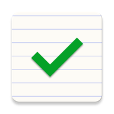

> Timely is an Android productivity application that helps users manage their time wisely by organizing goals within the limited time available each day.
---

## 💡 Motivation

Have you ever found yourself wondering where all your time went? It's easy to spend more time than intended on one activity and neglect to complete other important tasks. Timely was created to encourage intentional time management by treating time as a limited resource. Users can create reusable goals, assign realistic durations, and schedule them throughout the day while seeing exactly how much time remains available. By providing a clear visual representation of each day's schedule, Timely helps users build achievable plans and make more informed decisions about how they spend their time.

---
## Features

### Current Features

- **Goal planning:** Create and edit reusable goal templates, schedule goals for specific dates, and customize individual scheduled goals without changing their templates.
- **Recurring goals:** Create and edit recurring schedules, with lazy generation of future scheduled goals for long-running or open-ended recurrence rules.
- **Goal categories:** Create, rename, recolor, and delete categories; assign them to reusable and scheduled goals; and manage categories in Settings.
- **Category-aware scheduling:** New scheduled goals inherit their template's category, while individual scheduled goals can have a different category.
- **Category colors:** Optional, theme-aware category colors on goal cards, controlled through a display preference.
- **Category management and sorting:** Sort categories by name, color, reusable-goal count, or scheduled-goal count, in ascending or descending order.
- **Current task tracking:** Track time spent on a task, with pause and resume controls.
- **Notifications and reminders:** Receive task completion notifications and configure countdown reminders before a task's scheduled time runs out.
- **Notification preferences:** Configure reminder behavior and notification sound preferences.
- **Daily scheduling:** View daily goals, navigate between dates, and see remaining available time.
- **Analytics dashboard:** Review goal completion and time-utilization statistics.
- **Local data persistence:** Store goals, categories, recurrence rules, and scheduled tasks locally using Room.
- **Material Design 3 UI:** Jetpack Compose interface with reusable components and light/dark theme support.


### Planned Features

- [ ] Custom themes
- [ ] Current task expiration
- [ ] Goal completion history
- [ ] Cloud sync and backup

---

## 📸 Screenshots

| Home                                   | Calendar                        |
|----------------------------------------|---------------------------------|
| 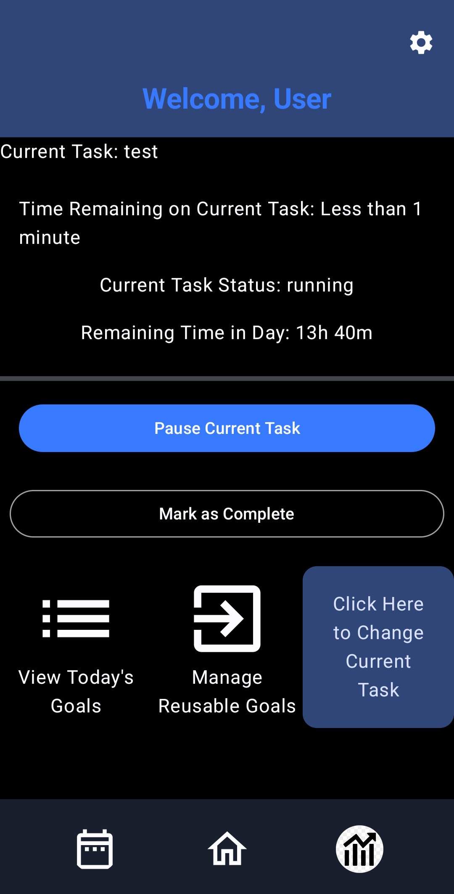 | 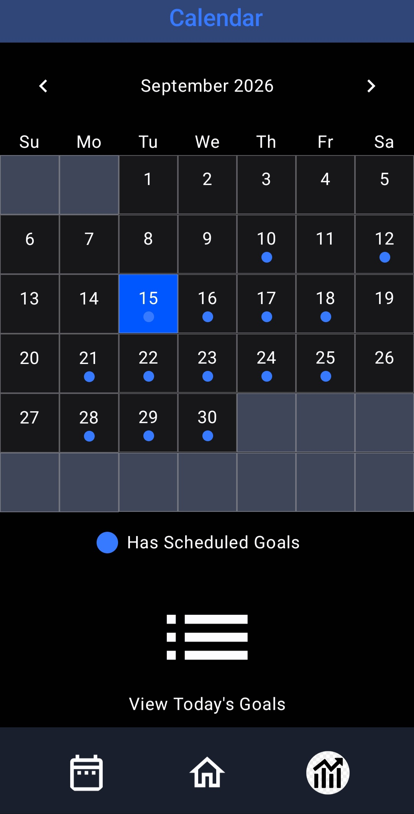 |

| View Goals                             | Edit Goals                      |
|----------------------------------------|---------------------------------|
| 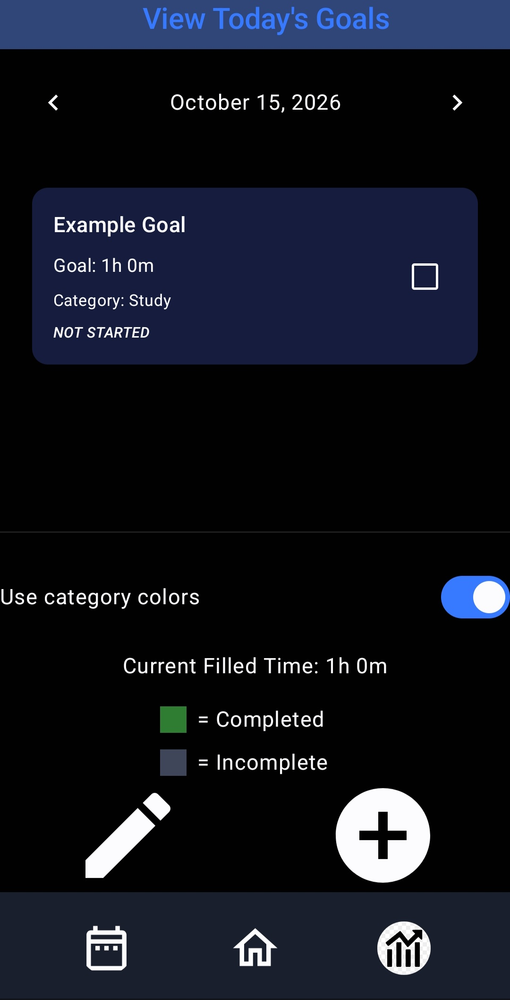 | 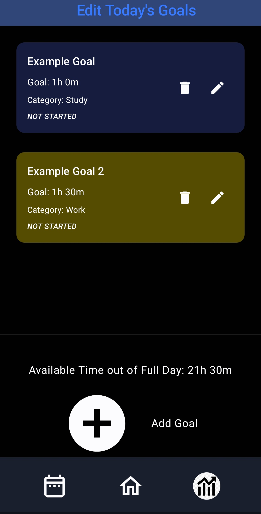 |

| Create Goal                            | Create Recurring Goal                    |
|----------------------------------------|---------------------------------|
| 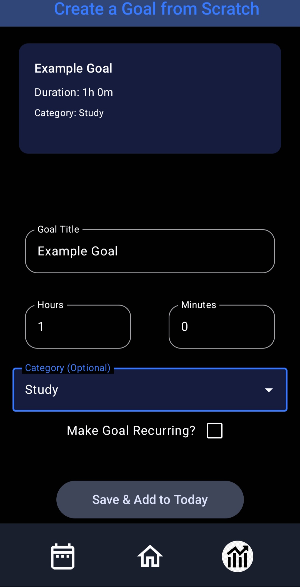 | 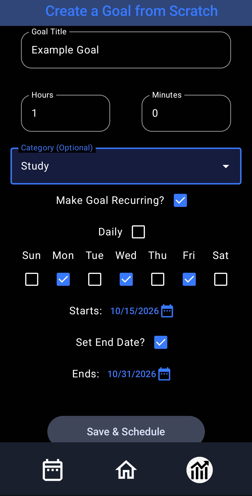 |

| Analytics Part 1                       | Analytics Part 2                |
|----------------------------------------|---------------------------------|
| 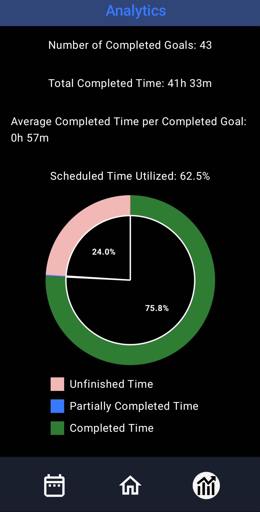 | 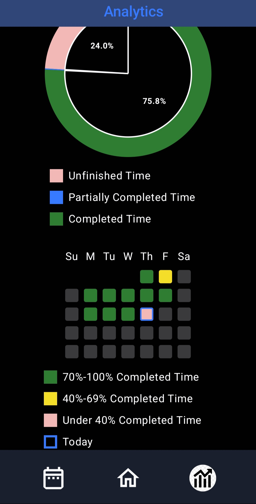 |

| Settings                               | Manage Categories               |
|----------------------------------------|---------------------------------|
| 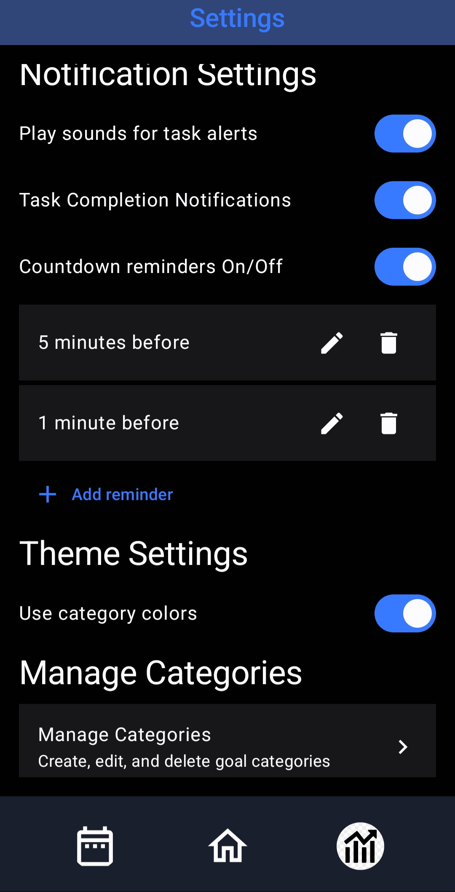 | 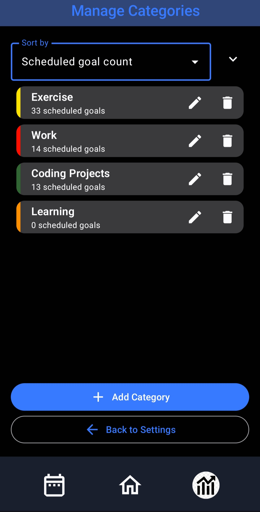 |
---

## 🎥 Demo

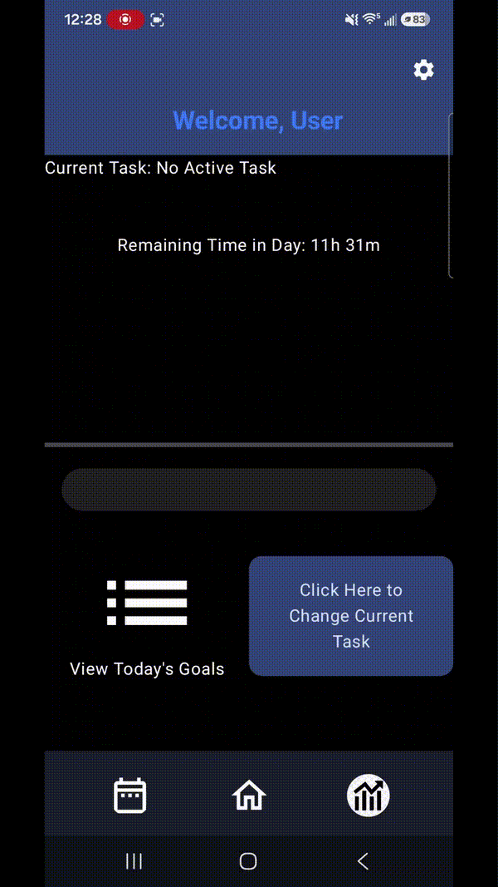

## Analytics Demo
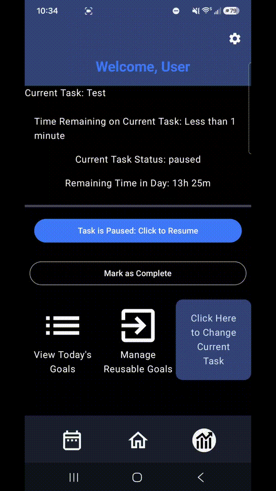

### Link To Full Demo Video
[Timely Demo Video (Youtube)](https://youtu.be/0Wy609OTCPI)

### Link To Recurring Goals Demo Video
[Timely Recurring Goals Demo (Youtube)](https://youtu.be/PaSeEHSdMRw)

### Link To Notification Reminders Demo Video
[Timely Notification Reminders Demo (Youtube)](https://youtu.be/Xk2nuA7isJE)

### Link To Categories Demo Video
[Timely Categories Demo (Youtube)](https://youtu.be/J56j2Jf2BOo)


## 🛠️ Built With

- Kotlin
- Jetpack Compose
- Material 3
- Room Database (SQLite)
- MVVM Architecture
- Repository Pattern
- Kotlin Coroutines
- StateFlow
- Navigation Compose
- DataStore Preferences
- Android notifications and alarm scheduling
- Android instrumentation testing (Room migration tests)

---

## 🏗️ Architecture

The application follows the **MVVM (Model–View–ViewModel)** architecture using a repository pattern and reactive UI state.

```text
UI (Jetpack Compose)
        │
        ▼
    ViewModels
        │
        ▼
   Repositories
        │
        ├── Room Database
        ├── DataStore Preferences
        └── Android Alarm / Notification APIs
```

**Goal categories** are stored separately from goals. Reusable goals and scheduled goals each reference a category, allowing an individual scheduled goal to be categorized independently of its template. Removing a category clears those references without deleting the goals.

**Reminder settings** are stored as user preferences, while the app's alarm and notification handling controls reminder delivery.

**Database migrations** use versioned Room schemas and migration tests to help preserve existing goals, scheduled goals, and recurrence data as the schema evolves. The category feature introduced database versions 18 and 19, with an upgrade path from version 17.

---

## 📂 Project Structure

```text
app/src/main/java/com/timelyproductivity/app
├── data/
│   ├── alarm/
│   ├── analytics/
│   ├── calendar/
│   └── goal/
│       └── recurrence/
│       └── category/
│   └── notification/
│   └── scheduledgoal/
│   └── AppContainer.kt
│   └── Converters.kt
│   └── TestData.kt
│   └── UserPreferencesRepository.kt
│
├── receiver/
│   └── TimerReceiver.kt
│
├── ui/
│   ├── add/
│   ├── analytics/
│   ├── calendar/
│   ├── categories/
│   ├── components/
        └── analytics/
        ├── categories/
        ├── lists/
        ├── settings/
        ├── time/
        ├── AddGoalButton.kt
        ├── ColorLegend.kt
        ├── ErrorMessageBox.kt
        ├── PermissionsDialog.kt
        ├── RecurrenceComponents.kt
│   └── createGoal/
│   └── currenttask/
│   └── editReusable/
│   └── editScheduled/
│   └── goal/
│   └── home/
│   └── navigation/
│   └── reminders/
│   └── settings/
│   └── theme/
│   └── viewgoals/
│   └── AppViewModelProvider.kt
│   └── TimelyScaffold.kt
│
├── util/
├── MainActivity.kt
├── TimelyApp.kt
└── TimelyApplication.kt 
```
- **data/** — Room entities, DAOs, repositories, recurrence and alarm logic, dependency providers, and user preferences.
- **receiver/** — Android broadcast receivers used for task timer and reminder events.
- **ui/** — Jetpack Compose screens, reusable components, ViewModels, navigation, and theming.
- **ui/categories/** — Category management and shared category editor state/actions.
- **ui/components/categories/** — Reusable category dropdown and editor dialog components.
- **util/** — Shared utility functions and helper classes.
- **MainActivity.kt** — Hosts the Compose application.
- **TimelyApp.kt** — Defines the root UI and navigation structure.
- **TimelyApplication.kt** — Initializes application-wide dependencies.
---

## 🚀 Getting Started

### Prerequisites

- Android Studio
- JDK 17+
- Android SDK

### Installation

```bash
git clone https://github.com/dylanrambo26/timely-app.git
```

Open the project in Android Studio and run it on an emulator or Android device.

---

## 📖 Usage

1. Create a reusable goal template with a title and estimated duration.
2. Optionally create or select a category for the goal.
3. Select a date and add an existing goal template or create a new scheduled goal.
4. Set up recurring days and an optional end date for goals that repeat.
5. Review the day's scheduled goals and remaining available time.
6. Edit an individual scheduled goal's title, duration, or category without changing its reusable template.
7. Start a task timer and pause or resume it as needed.
8. Configure notification preferences and optional countdown reminders; allow notification permissions when prompted.
9. Receive a notification when the task timer completes, if notifications are enabled.
10. Use category colors to distinguish goals visually, or use the standard goal status colors.
11. Open **Manage Categories** in Settings to edit, delete, or sort categories by name, color, or associated goal counts.
12. Visit Analytics to review goal completion and time utilization.

---

## 🗺️ Roadmap

### ✅ Completed

- [x] Reusable goals
- [x] Scheduled goals and daily scheduling
- [x] Recurring goals and future-goal generation
- [x] Current task time tracking and pause/resume
- [x] Task completion notifications
- [x] Configurable countdown reminders and notification preferences
- [x] Goal categories and category assignment
- [x] Category inheritance and individual scheduled-goal customization
- [x] Category colors with light/dark theme support
- [x] Category management (create, edit, delete)
- [x] Category sorting by name, color, and associated goal counts
- [x] Remaining time calculation
- [x] Navigation between screens and dates
- [x] Analytics dashboard
- [x] Room database migrations and migration tests for category schema updates

### 📅 Planned

- [ ] Custom themes
- [ ] Current task expiration
- [ ] Goal completion history
- [ ] Cloud sync and backup

---

## 📄 License

This project is licensed under the MIT License.

---

## 👤 Author

**Dylan Rambo**

- GitHub: https://[github.com/dylanrambo26](https://github.com/dylanrambo26)
- LinkedIn: https://[linkedin.com/in/dylan-rambo-4b80b4353/](https://www.linkedin.com/in/dylan-rambo-4b80b4353/)